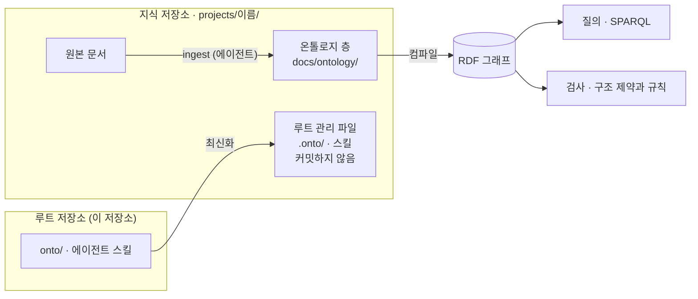

# ontology

여러 저장소에 흩어진 문서를 저장소마다 온톨로지로 정리하고, 하나로 합쳐 질의하고 검사하는 **모듈형 온톨로지** 도구입니다.

LLM 에이전트가 원본 문서를 읽어 페이지를 쓰고, 사람은 `git diff`로 검토합니다. 페이지는 RDF 그래프로 컴파일되어 SPARQL로 질의하고 규칙으로 검사합니다. [Karpathy의 LLM Wiki 패턴](https://gist.github.com/karpathy/442a6bf555914893e9891c11519de94f)을 뼈대로 삼고 RDF 온톨로지와 git 서브모듈 구조를 더했습니다.

## 왜 필요한가

프로젝트마다 계획, 정책, 구현 결과 문서가 제각각이라 에이전트는 지식이 필요할 때마다 원본을 처음부터 읽고, 프로젝트 사이의 관계는 어디에도 남지 않습니다. 이 도구는 저장소마다 정리된 온톨로지 층을 두고 전체를 한곳에서 질의하게 합니다. 각 저장소 안에서는 그 저장소의 지식만 보입니다.

## 동작 방식



- **루트 저장소**(이 저장소)는 기능만 갖고, 지식은 서브모듈로 붙인 **지식 저장소**에 있습니다.
- 에이전트는 원본 문서를 고치지 않고 `docs/ontology/`에 페이지를 따로 씁니다.
- 루트가 기능을 지식 저장소에 복사해 주고(**최신화**), 복사된 파일(**루트 관리 파일**)은 커밋되지 않습니다. 지식 저장소 안에서도 그 저장소의 지식만 대상으로 명령과 스킬을 쓸 수 있습니다.

자세히 보기: [동작 방식](docs/guide/how-it-works.md) · [용어집](GLOSSARY.md)

## 빠른 시작

### 도구 설치

`git`, `just`, `uv`가 필요합니다. `just`는 이 저장소의 모든 명령(`Justfile`)을 실행하고, `uv`는 온톨로지 도구(Python)를 실행합니다. 레시피가 POSIX `sh`로 쓰여 있어 macOS와 Linux에서 씁니다.

```sh
# macOS (Homebrew)
brew install just uv

# Linux
curl -LsSf https://astral.sh/uv/install.sh | sh
# 새 셸을 연 뒤
uv tool install rust-just    # just의 PyPI 배포판
```

`just`는 1.35 이상을 씁니다(1.35부터 확인했습니다). `Justfile`이 모듈과 `set working-directory`를 쓰기 때문에, Ubuntu 24.04의 `apt install just`가 주는 1.21 같은 오래된 버전은 읽지 못합니다. 설치한 뒤 `just --version`으로 확인하세요. Python 3.11 이상이 없으면 `uv`가 받아 옵니다. 다른 설치 방법은 [just](https://just.systems/man/en/packages.html)와 [uv](https://docs.astral.sh/uv/getting-started/installation/)의 공식 안내에 있습니다.

### 받아서 시작하기

```sh
git clone https://github.com/powerumc/ontology my-ontology && cd my-ontology
git remote set-url origin <내 원격 저장소 주소>     # 받은 저장소를 내 루트 저장소로 만듭니다
just setup
just repo add <지식 저장소 주소> [이름] [브랜치]
git commit -m "chore: <이름> 지식 저장소를 등록한다"
just git push
```

공개 원본에는 지식 저장소를 등록할 수 없으니 `origin`부터 바꿔 주세요. 다른 기기에서는 내 루트 저장소를 클론하고 `just setup`만 실행하면 같은 구성이 됩니다.

자세히 보기: [시작하기](docs/guide/getting-started.md)

## 지식을 갱신하는 흐름

원본 문서가 생기거나 바뀌면 에이전트에게 정리를 맡기고, 사람은 검토하고 커밋합니다. ingest는 요청할 때만 실행되고 자동으로 돌지 않습니다.

| 단계 | 누가 | 어떻게 |
|---|---|---|
| 1. 정리 | 에이전트 | "billing을 onto-ingest로 정리해 줘" |
| 2. 검토 | 사람 | `git -C projects/billing status`, `git -C projects/billing diff` |
| 3. 커밋 | 사람 | 지식 저장소에 커밋한 뒤 루트 저장소에 커밋 |
| 4. 푸시 | 사람 | `just git push` |

1단계에서 에이전트는 대상 확인(`just onto status`), 페이지 쓰기, 컴파일과 검사(`just onto build`, `just onto validate`), 원본과의 대조 검토까지 하고 커밋 메시지를 제안합니다. 대상 확인과 검사를 명령으로 직접 하는 법은 [ingest](docs/guide/ingest.md)에 있습니다.

푸시 전에 스크립트 검사가 다시 돌고, 오류가 있으면 아무것도 올리지 않습니다(**푸시 관문**). 온톨로지 층을 바꾸는 커밋은 `onto(ingest): <요약>`이나 `onto(lint): <요약>` 형식으로 씁니다.

자세히 보기: [ingest](docs/guide/ingest.md) · [검사와 규칙](docs/guide/validate.md) · [받기와 푸시](docs/guide/git.md)

## 명령

| 명령 | 하는 일 | 안내 |
|---|---|---|
| `just setup` | 클론한 루트 저장소를 쓸 수 있게 준비 | [시작하기](docs/guide/getting-started.md) |
| `just repo add <url> [이름] [브랜치]` | 지식 저장소를 `projects/<이름>/`에 붙이기 | [붙이기와 떼기](docs/guide/knowledge-repos.md) |
| `just repo remove <이름> [--force]` | 지식 저장소를 흔적까지 떼기 | [붙이기와 떼기](docs/guide/knowledge-repos.md) |
| `just onto status` | ingest할 원본 문서 보기 | [ingest](docs/guide/ingest.md) |
| `just onto build` | 그래프와 인덱스 만들기 | [질의](docs/guide/query.md) |
| `just onto query '<SPARQL>'` | SPARQL 질의 | [질의](docs/guide/query.md) |
| `just onto validate` | 스크립트 검사 | [검사와 규칙](docs/guide/validate.md) |
| `just onto rules [이름]` | 적용되는 규칙을 JSON으로 보기 | [검사와 규칙](docs/guide/validate.md) |
| `just onto sync [이름]` | 루트의 기능을 지식 저장소에 최신화 | [최신화](docs/guide/sync.md) |
| `just git status` | 저장소별 미커밋, 미푸시, 뒤처짐 요약 | [받기와 푸시](docs/guide/git.md) |
| `just git pull` | 모든 저장소를 fast-forward로 받기 | [받기와 푸시](docs/guide/git.md) |
| `just git push` | 스크립트 검사 뒤 모든 저장소 푸시 | [받기와 푸시](docs/guide/git.md) |
| `just git push --force` | 검사에 오류가 있어도 푸시 | [받기와 푸시](docs/guide/git.md) |

어떤 명령도 자동으로 커밋하지 않습니다. `just`, `just onto`처럼 모듈 이름까지만 실행하면 명령 목록이 나옵니다. 스킬이 없는 명령도 에이전트에게 말로 맡길 수 있습니다(예: "모든 저장소의 상태를 요약해 줘"). 명령을 다루는 안내 문서에 말하는 예시가 함께 있습니다.

지식 저장소 안에서는 복사된 `Justfile`을 지정해 그 저장소의 지식만 다룹니다([지식 저장소 안에서 쓰기](docs/guide/inside-knowledge-repo.md)).

```sh
cd projects/billing
just -f .onto/Justfile build
just -f .onto/Justfile validate
just -f .onto/Justfile query 'SELECT ?e WHERE { ?e a onto:Term }'
just -f .onto/Justfile status
```

## 에이전트 스킬

| 스킬 | 하는 일 | 이렇게 말합니다 |
|---|---|---|
| [`onto-ingest`](.claude/skills/onto-ingest/SKILL.md) | 새로 생겼거나 바뀐 원본 문서를 페이지로 정리 | "billing을 onto-ingest로 정리해 줘" |
| [`onto-query`](.claude/skills/onto-query/SKILL.md) | 지식 저장소에 대한 질문에 근거가 된 페이지와 함께 답함 | "결제 API에 의존하는 컴포넌트를 모두 찾아 줘" |
| [`onto-lint`](.claude/skills/onto-lint/SKILL.md) | 모순, 근거 없는 문장, 인용 누락, 빠진 개념을 찾아 보고 | "billing을 onto-lint로 점검해 줘" |

스킬 이름을 말하지 않아도 요청이 스킬에 맞으면 에이전트가 그 스킬을 씁니다. Claude Code에서는 `/onto-ingest billing`처럼 슬래시 명령으로 바로 부를 수도 있습니다.

스킬은 원본 문서를 고치지 않고 커밋하지 않습니다. 루트 저장소에서는 붙인 지식 저장소 전체를, 지식 저장소 안에서는 그 저장소만 다루고, `onto-ingest`는 한 번에 지식 저장소 하나만 정리합니다.

## 문서

| 알고 싶은 것 | 문서 |
|---|---|
| 저장소 구성, 온톨로지 층, 최신화, 디렉토리 구조 | [동작 방식](docs/guide/how-it-works.md) |
| 받아서 내 루트 저장소로 만들기, 새 기기 설정 | [시작하기](docs/guide/getting-started.md) |
| 지식 저장소를 붙이고 떼는 규칙 | [지식 저장소 붙이기와 떼기](docs/guide/knowledge-repos.md) |
| 원본 문서를 페이지로 정리하고 커밋하기 | [ingest](docs/guide/ingest.md) |
| SPARQL 질의와 `build` 산출물 | [질의](docs/guide/query.md) |
| 스크립트 검사, LLM 검사, 규칙 덮어쓰기 | [검사와 규칙](docs/guide/validate.md) |
| `pull`, `push`, 푸시 관문 | [받기와 푸시](docs/guide/git.md) |
| 기능을 지식 저장소에 반영하기 | [최신화](docs/guide/sync.md) |
| 지식 저장소 안에서 명령과 스킬 쓰기 | [지식 저장소 안에서 쓰기](docs/guide/inside-knowledge-repo.md) |
| 페이지를 쓰는 법(키, 클래스, 식별자, 관계, `derivedFrom`) | [온톨로지 층 규약](onto/template/conventions.md). 지식 저장소에는 `.onto/template/conventions.md`로 복사됨 |
| 용어의 뜻 | [용어집](GLOSSARY.md) |
| 되돌리기 어려운 결정과 그 이유 | [ADR](docs/adr/) |

이 저장소를 개발한다면 [테스트 안내](tests/README.md), [에이전트용 문서 규약](docs/agents/), [스펙 이슈 #1](https://github.com/powerumc/ontology/issues/1), [이슈 목록](https://github.com/powerumc/ontology/issues)을 보세요.

## 참고한 사례

- [Karpathy LLM Wiki gist](https://gist.github.com/karpathy/442a6bf555914893e9891c11519de94f): 원본 소스, 위키, 스키마 파일의 3개 층과 ingest, query, lint의 3개 운영
- [LA3D/llm-wiki-colab](https://la3d.github.io/llm-wiki-colab/): 연합형 확장. OWL/SKOS 관계, JSON-LD context, SHACL
- [wazootech/wiki](https://github.com/wazootech/wiki): frontmatter를 RDF로 변환하고 소스별 named graph로 적재
